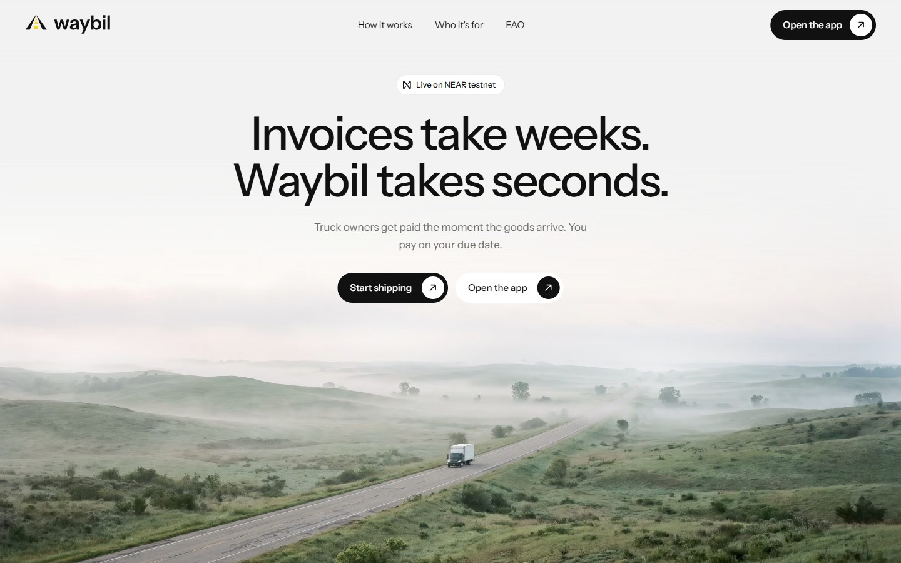
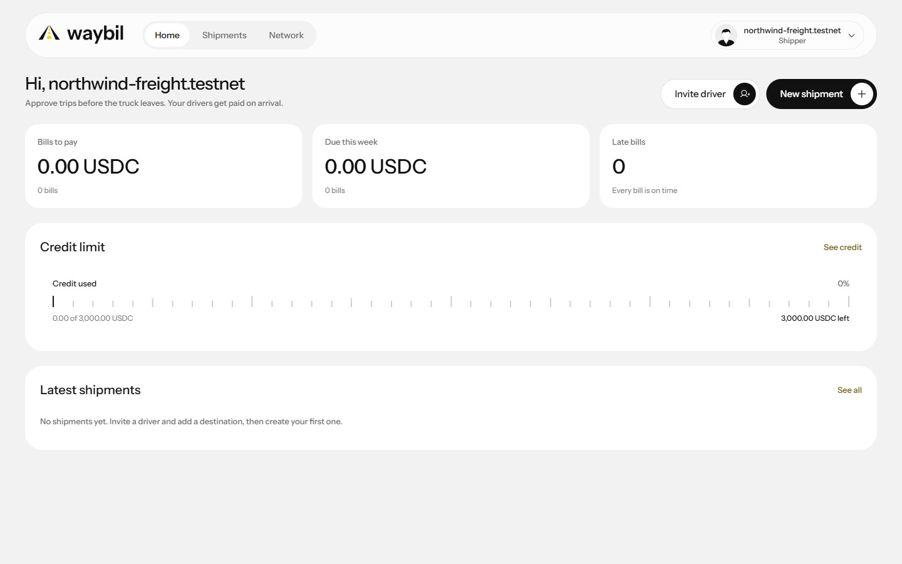
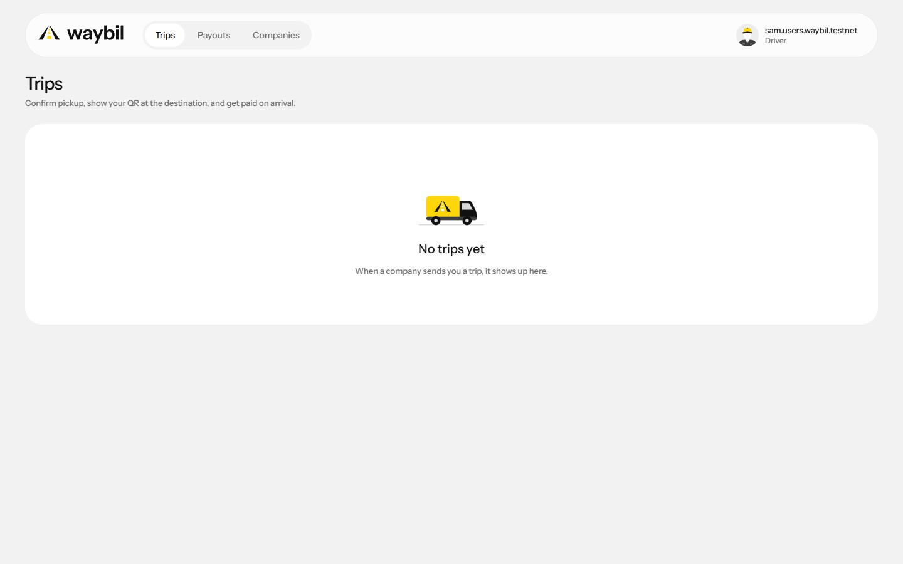
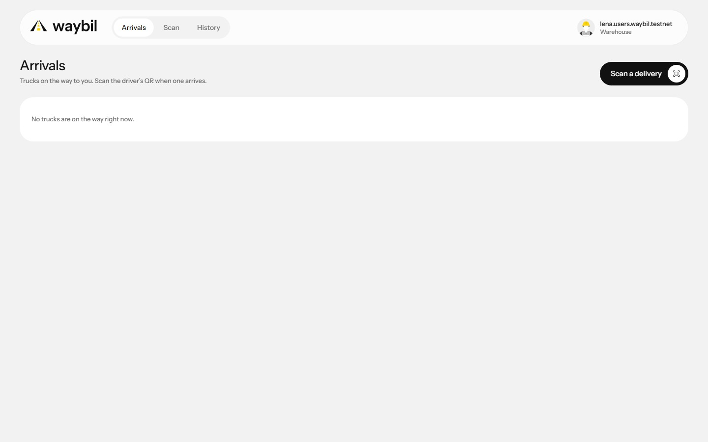
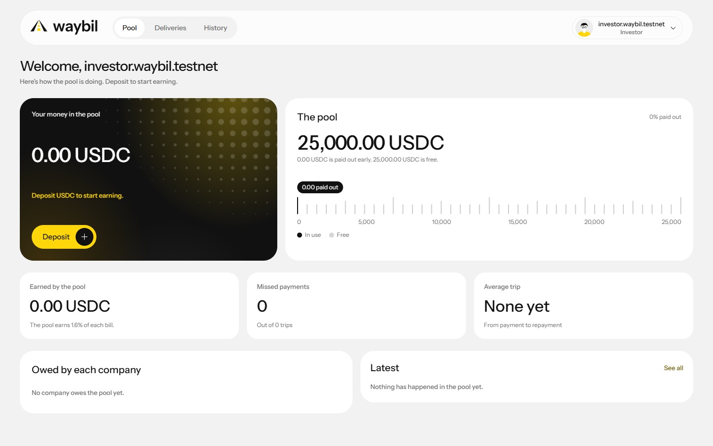
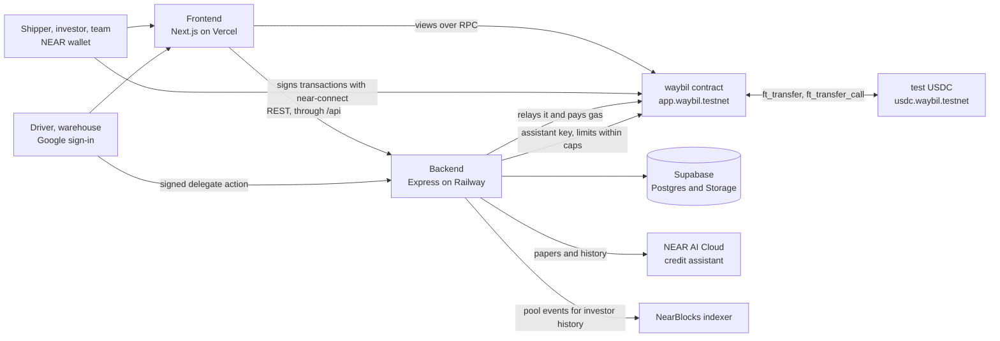

<p align="center">
  <picture>
    <source media="(prefers-color-scheme: dark)" srcset="fe/public/brand/waybil-lockup-reversed.svg" />
    
  </picture>
</p>

<h1 align="center">Waybil</h1>

Waybil pays a truck owner the moment the receiving warehouse confirms the goods arrived,
instead of weeks later when the shipping company pays. The money comes from a lending pool
that investors fund with USDC. The shipping company repays the full bill to the pool by a due
date it agreed to before the truck left.

Three confirmations make a bill real, and each one is recorded on NEAR. The shipper approves
the trip, the driver confirms pickup, and the warehouse confirms arrival. Only then does the
contract pay the driver 97.5% of the fee. Drivers and warehouses sign in with Google and never
see a wallet or pay gas. Shippers, investors and the team use a NEAR wallet.

Built for NEAR HACKATHON 2026. Everything runs on NEAR testnet with test USDC.

<p align="center">
  <a href="#live-demo-and-contracts">Live demo and contracts</a> ·
  <a href="#screenshots">Screenshots</a> ·
  <a href="#working-features">Working features</a> ·
  <a href="#how-to-try-the-demo">How to try the demo</a>
  <br />
  <a href="#why-near">Why NEAR</a> ·
  <a href="#architecture-and-tech-stack">Architecture and tech stack</a> ·
  <a href="#local-setup">Local setup</a> ·
  <a href="#contract-deployment-and-upgrades">Contract deployment and upgrades</a>
  <br />
  <a href="#limitations-and-future-work">Limitations and future work</a> ·
  <a href="#libraries-and-ai-generated-code">Libraries and AI-generated code</a> ·
  <a href="#team">Team</a>
</p>

---

## Live demo and contracts

| What | Link |
|---|---|
| Website | [waybil.xyz](https://www.waybil.xyz) |
| App (live demo) | [app.waybil.xyz](https://app.waybil.xyz/start) |
| API health | [api.waybil.xyz/health](https://api.waybil.xyz/health) |
| GitHub | [AncungAulia/waybil-near](https://github.com/AncungAulia/waybil-near) |
| Demo video | <!-- Link the demo post on X here. --> Coming soon |

| Resource | Value |
|---|---|
| Network | **NEAR testnet** |
| RPC | `https://test.rpc.fastnear.com` ([other public providers](https://docs.near.org/api/rpc/providers)) |
| Testnet NEAR for gas | [near-faucet.io](https://near-faucet.io). Drivers and warehouses need none. |
| Test USDC | The app's wallet menu has **Get test USDC**, which gives 1,000 USDC once a day per account. |
| Wallets | Any NEAR wallet that near-connect lists and that supports testnet, for example Meteor or Intear |

| Account | What it is | Explorer |
|---|---|---|
| `app.waybil.testnet` | Main contract: shipments, bills, payouts, credit limits, the lending pool and team votes | [NearBlocks](https://testnet.nearblocks.io/address/app.waybil.testnet) |
| `usdc.waybil.testnet` | Test USDC, NEP-141 with 6 decimals and a faucet | [NearBlocks](https://testnet.nearblocks.io/address/usdc.waybil.testnet) |
| `relayer.waybil.testnet` | Pays the gas for drivers' and warehouses' meta transactions | [NearBlocks](https://testnet.nearblocks.io/address/relayer.waybil.testnet) |
| `users.waybil.testnet` | Parent of every Google user account (`<name>.users.waybil.testnet`) | [NearBlocks](https://testnet.nearblocks.io/address/users.waybil.testnet) |
| `assistant.waybil.testnet` | The credit assistant's key, allowed to set limits within fixed caps | [NearBlocks](https://testnet.nearblocks.io/address/assistant.waybil.testnet) |
| `risk.`, `ops.`, `finance.waybil.testnet` | The three team members. Any two approve new shippers, big limit changes and code upgrades. | [risk](https://testnet.nearblocks.io/address/risk.waybil.testnet) |

`app.waybil.testnet` has had no access key since Nov 11, 2026. Nobody, the deployer included,
can change its code alone. The only way is a team upgrade with 2 of 3 votes (see
[Contract deployment and upgrades](#contract-deployment-and-upgrades)).

---

## Screenshots

### Landing page

<p align="center">
  <a href="docs/screenshots/landing.jpeg">
    
  </a>
</p>

### The app on testnet

<table>
  <tr>
    <th width="50%">Shipper</th>
    <th width="50%">Driver</th>
  </tr>
  <tr>
    <td valign="top">
      <a href="docs/screenshots/shipper.jpeg"></a>
    </td>
    <td valign="top">
      <a href="docs/screenshots/driver.jpeg"></a>
    </td>
  </tr>
  <tr>
    <th width="50%">Warehouse</th>
    <th width="50%">Investor</th>
  </tr>
  <tr>
    <td valign="top">
      <a href="docs/screenshots/warehouse.jpeg"></a>
    </td>
    <td valign="top">
      <a href="docs/screenshots/investor.jpeg"></a>
    </td>
  </tr>
</table>

These are the live screens with `NEXT_PUBLIC_LIVE=on`, reading the contract on testnet for the
demo accounts `northwind-freight.testnet`, `sam.users.waybil.testnet`,
`lena.users.waybil.testnet` and `investor.waybil.testnet`.

---

## Working features

- **Sign-in by role.** The first screen asks what the person does.
  - Shippers, investors and the team sign a NEP-413 message with their NEAR wallet.
  - Drivers and warehouse staff continue with Google. The browser makes an Ed25519 device key
    that never leaves the phone, and the backend creates `<name>.users.waybil.testnet` with
    that key limited to the contract.
- **Shipper onboarding.** A company sends its details, business registration and a 3-month bank
  statement. The credit assistant checks them privately and suggests a starting limit, and two
  team members approve it.
- **Network.** A shipper invites drivers and receiving warehouses by link. After they accept,
  the shipper adds them on chain with one wallet approval. A driver can also share a link with
  their own account.
- **Shipments.** The shipper approves a trip with a driver, destination, cargo, fee and due date
  up to 60 days ahead. The bill must fit the remaining credit limit and the pool's free cash.
  An approved trip can be cancelled before pickup.
- **Pickup and arrival.**
  - The driver confirms pickup from the phone, then shows a QR and an 8-character code at the
    destination.
  - The warehouse scans the QR or types the code and confirms the count.
  - Both actions are signed by the device key and relayed by the backend, so they need no
    wallet and no gas.
- **Instant payout.** When the warehouse confirms all units, the contract sends the driver 97.5%
  of the fee right away, as part of that confirmation.
- **Problem reports.** When goods are short or damaged, the warehouse sends reasons, a note and
  up to 5 photos. The payout waits until the shipper settles it with an amount for the driver,
  and the bill changes to match.
- **Repayment.** The shipper pays the bill with `ft_transfer_call`. The bill splits into 1.6% for
  the pool, 0.4% for the safety reserve and 0.5% for Waybil. A late bill blocks new shipments
  until it is paid.
- **Lending pool.**
  - Investors deposit test USDC for pool shares and see the pool's value, free cash, deliveries
    and earnings. Their history lists every deposit and withdrawal from the contract's own
    events, each with its NearBlocks link.
  - Withdrawals pay the free part now and queue the rest, paid oldest first as bills are
    repaid. Anyone can pay out the queue.
- **Team screens.**
  - Members vote on proposals, with a reason when they say no.
  - They approve or reject shipper applications after reading the papers and the private
    check, change limits, and pause a shipper with a note.
  - They watch the pool and the withdrawal queue.
- **Credit assistant.** It runs on NEAR AI Cloud. It reads papers and payment history in a
  private computer, and the backend checks its signed result. It can raise a limit up to 20% a
  week and never above 10,000 USDC. Bigger changes become a team proposal.
- **Names, not account ids.** Screens show company and people names from the backend, without
  phone numbers or emails. A warehouse finds its destinations from the invites it accepted.
- **Receipts.** Every recorded action links to its transaction: "See the record on NearBlocks".

---

## How to try the demo

Use a separate browser profile for each role, because each account has one role. Shippers,
investors and the team need a NEAR testnet wallet with a little testnet NEAR for gas. Drivers
and warehouses only need a Google account.

**Shortest check: the pool (about 3 minutes)**

1. Open [app.waybil.xyz/start](https://app.waybil.xyz/start) and choose **I fund deliveries**.
   Connect a testnet wallet and approve the sign-in message.
   You land on the pool page with "Welcome" and the pool's total.
2. Open the account menu (top right) and choose **Get test USDC**. Approve the `faucet` call.
   Your balance shows 1,000.00 USDC.
3. On the pool page choose **Deposit**, enter 100 and approve in the wallet.
   You see "Deposit received" with a NearBlocks link. Your money in the pool shows about
   100.00 USDC, and the pool total goes up by 100.
4. Choose **Withdraw**, enter 50 and approve.
   You see "Withdrawn". Your money in the pool and the pool total go down by 50.

**Full delivery: a shipper, a driver and a warehouse**

1. **Apply as a shipper.** In a second profile, choose **I ship goods** and connect a different
   wallet. Fill in the company details, upload a registration and a bank statement (PDF, JPG or
   PNG, up to 2 MB), and send them.
   You see "We're checking your company".
2. **Approval.** Two team members approve the starting limit on `/admin`. The team holds these
   keys, so a judge can't do this step alone. Once it is approved, reload
   `/onboarding/shipper`.
   You see "You're approved" with your credit limit.
3. **Invite a driver.** On **Network**, choose **Invite a driver**, enter a name and a WhatsApp
   number with the country code, and copy the link.
   Open it in a third profile and choose **Continue with Google**.
   You see "You're connected".
4. **Add a destination.** Back as the shipper, choose **Add a destination** and send that link
   the same way to a fourth profile, which signs in with Google as the warehouse.
   You see "You're all set".
5. **Add both to the network.** As the shipper, both people now show under **Ready to add**.
   Choose **Add to your network** for each and approve in the wallet.
6. **Create a shipment.** Choose **New shipment**. Pick the driver and the destination, enter
   for example 20 crates, a bill of 100 USDC and a due date next week, and approve.
   You see the shipment as "Approved" with a NearBlocks link.
7. **Pickup.** As the driver, open the trip and choose **Confirm pickup**.
   There is no wallet prompt. The trip shows a QR and an 8-character code.
8. **Arrival.** As the warehouse, choose **Scan a delivery** and scan the QR or type the code.
   Keep the count at 20 and choose **Confirm delivery**.
   You see "Confirmed". Within a few seconds the driver's trip shows "You got paid" with
   97.50 USDC.
9. **Repay.** As the shipper, get test USDC from the account menu, open the shipment and pay
   100 USDC.
   The shipment shows "Repaid", and your credit is free again.

To try a problem report, enter fewer good units in step 8 and add a photo. The shipment then
shows "Problem reported", and the shipper settles it from the shipment page.

The driver's trip and the warehouse's arrivals read the chain again every few seconds. On other
pages, reload to see another person's action. If a wallet request is declined, nothing is
recorded, and you can try again from the same screen.

---

## Why NEAR

- **Proof, not promises.** Shipments, confirmations, payouts, limits and pool shares live in one
  Rust contract. Only the recorded driver can confirm pickup. Only the destination's warehouse
  can confirm arrival. The contract checks the credit limit and the pool's free cash before it
  pays anyone. Investors lend against that recorded proof.
- **No wallet for people who drive trucks.** NEP-366 meta transactions and function-call access
  keys let a phone sign a confirmation that the relayer pays for. Named sub-accounts
  (`<name>.users.waybil.testnet`) give each Google user a real NEAR account without a seed
  phrase.
- **Stablecoin rails.** USDC is a NEP-141 token. Deposits and repayments arrive with
  `ft_transfer_call` in one step. Payouts and withdrawals roll back if the transfer fails.
- **Private credit checks.** NEAR AI Cloud runs the credit assistant in a private computer.
  Company papers and bank statements are checked without exposing them, and the result is
  signed and verified before it can change a limit.
- **A team that can't act alone.** New shippers, big limit changes, reserve covers and code
  upgrades need 2 of 3 members in the contract itself. The contract has no access key, so even
  a code upgrade goes through a team vote.

Personal data never goes on chain. Names, phone numbers, addresses, papers and photos stay in
the backend, and the contract keeps a sha256 hash where proof is needed.

---

## Architecture and tech stack



- **The frontend reads the chain directly** over RPC. The backend keeps off-chain data only,
  such as names, invites, papers, photos and reasons. It never mirrors chain state.
- **Wallet users sign their own transactions.** The backend never holds their keys.
- **The backend checks every relayed action.** It only relays `confirm_pickup` and
  `confirm_delivery` to `app.waybil.testnet`, from the signed-in person, with at most 100 Tgas
  and no deposit.

| Folder | What it is |
|---|---|
| [contracts/waybil](contracts/waybil) | Main contract. Rust, near-sdk 5.x, built with cargo-near |
| [contracts/mock-usdc](contracts/mock-usdc) | Test USDC. NEP-141, 6 decimals, faucet |
| [fe/](fe/README.md) | App for all five roles. Next.js, TypeScript, Tailwind CSS, near-connect |
| [be/](be/README.md) | API, relayer and credit assistant. Express, TypeScript, near-api-js, Supabase |
| [landing-page/](landing-page) | Public landing page. Next.js |
| [packages/shared](packages/shared) | TypeScript types and money helpers shared by fe and be |
| [scripts/](scripts) | Testnet deploy, seed and team upgrade |
| [docs/](docs) | [Product](docs/PRODUCT.md), [architecture](docs/ARCHITECTURE.md), [specs](docs/specs) and [decisions](docs/decisions) |

---

## Local setup

### Prerequisites

- Node.js **22 or newer** and **pnpm 12** (`corepack enable` installs it).
- For the contracts only: Rust, [cargo-near](https://github.com/near/cargo-near) and
  [near-cli-rs](https://github.com/near/near-cli-rs). The app and API don't need them.

```sh
git clone https://github.com/AncungAulia/waybil-near.git
cd waybil-near
pnpm install
```

`pnpm install` ends with "Done" and no peer dependency warnings.

### Frontend against the live API and testnet

This is the fastest way to run the app, because it needs no backend or database of your own.

```sh
cp fe/.env.example fe/.env.local
pnpm --filter @waybil/fe dev
```

Open http://localhost:3001.

| Variable in `fe/.env.local` | Value |
|---|---|
| `API_URL` | `https://api.waybil.xyz`. Server side only. The browser calls `/api/*`, and Next.js forwards it, so localhost works with the live API. |
| `NEXT_PUBLIC_NEAR_RPC_URL` | `https://test.rpc.fastnear.com` |
| `NEXT_PUBLIC_WAYBIL_CONTRACT` / `NEXT_PUBLIC_USDC_CONTRACT` | `app.waybil.testnet` / `usdc.waybil.testnet` |
| `NEXT_PUBLIC_LIVE` | Leave empty for the labeled demo with sample data, so you can click through every role without a wallet. Set `on` for testnet. |
| `NEXT_PUBLIC_GOOGLE_CLIENT_ID` | Needed for driver and warehouse sign-in when LIVE is on. It must be the backend's client id, with `http://localhost:3001` among its authorized origins. |
| `NEXT_PUBLIC_GALLERY` | `on` opens `/dev/gallery`, every screen state on one page. Leave empty when deployed. |

Never put a secret in a `NEXT_PUBLIC_*` variable.

### Backend

```sh
cp be/.env.example be/.env
pnpm --filter @waybil/be dev
```

http://localhost:4000/health answers `{"status":"ok"}` with no credentials. The other routes
need Supabase, the relayer and user-parent keys, a Google client id and a NEAR AI key.
[be/README.md](be/README.md) lists every variable, the migrations and the production commands.
Keys live only in `be/.env` and the hosting settings. They are never committed.

### Landing page

```sh
cp landing-page/.env.example landing-page/.env.local
pnpm --filter @waybil/landing-page dev
```

Open http://localhost:3000.

### Build and test

From the repository root:

```sh
pnpm lint
pnpm typecheck
pnpm test
pnpm format:check
pnpm --filter @waybil/fe build
pnpm --filter @waybil/be build
```

Each one ends without errors. Unit tests mock the chain and Supabase and need no live keys.

For the contracts, from `contracts/waybil/` or `contracts/mock-usdc/`:

```sh
cargo test
cargo clippy --target wasm32-unknown-unknown --lib -- -D warnings
cargo near build non-reproducible-wasm --no-abi
```

`cargo test` also runs sandbox tests on Linux and macOS. near-sandbox has no Windows build,
so CI runs them. Each contract's ABI is committed at `contracts/<name>/abi/<name>.json`, and CI
fails when it is out of date (`pnpm --filter @waybil/scripts abi` regenerates it).

---

## Contract deployment and upgrades

The contracts are already live at the accounts above, so you don't need to deploy anything to
try Waybil.

To deploy your own copy you need Rust, cargo-near and near-cli-rs, plus the deployer key in
your keychain. Then run `pnpm --filter @waybil/scripts deploy-contracts`. It creates the
accounts, builds and deploys the contract and prints its team and pool when it is done.
On a contract that is already running it deploys the new code with `migrate` as the init call.
`pnpm --filter @waybil/scripts seed` sets up the demo story again, and is safe to rerun. Both
commands send real testnet transactions.

**Code changes need 2 of 3 team votes.** `app.waybil.testnet` has no access key since
Nov 11, 2026, so nobody can deploy to it alone, the deployer included. The only way to change
the code is a team upgrade (decisions [0005](docs/decisions/0005-contract-upgrades.md) and
[0012](docs/decisions/0012-upgrade-code-in-the-approval.md)). Version 0.2.0 was shipped this way
(proposal #6). Build the wasm from the tagged commit, then run
`pnpm --filter @waybil/scripts team-upgrade --wasm <absolute path to waybil.wasm> --proposer risk.waybil.testnet --approver ops.waybil.testnet`
with both members' keys in your keychain. It proposes the code hash, sends the code with the
second approval and prints the new version and code hash. The approving member needs about
0.35 NEAR, because the transaction prepays 300 Tgas for 330 KB of code. `get_code_info` returns
the version and the code hash that is live now.

---

## Limitations and future work

- **Testnet only.** USDC is a test token with a faucet, and pool balances are demo funding, not
  real freight activity. There is no mainnet deployment and no security audit.
- **People approve new shippers.** The team holds the three member keys, so the full delivery
  walkthrough needs a team member to approve a new shipper.
- **The arrival code is derived.** It is the shipment id in base 36, 8 characters long. Knowing
  it gives no access, because only that destination's warehouse can confirm a shipment that is
  on the road. A stored random code is a small change.
- **The pool scans shipments.** The pool page finds the deliveries it paid for by reading
  shipment ids in order. That is fine for testnet, but needs a view or an indexer at scale.
- **Investor history depends on NearBlocks.** A plain RPC node can't search past events, so the
  backend reads the contract's pool events through the NearBlocks indexer. Its free plan limits
  requests, so a new deposit can take a minute to show in History.
- **The warehouse's count is trusted input.** The design board's map preview is not live
  tracking.
- **Not covered yet.** The reserve covering an unpaid bill is a team proposal. Collections and
  legal recovery beyond the reserve are not part of the product.

---

## Libraries and AI-generated code

| Part | Main libraries |
|---|---|
| Contracts | near-sdk, near-contract-standards, cargo-near |
| Frontend | Next.js, React, Tailwind CSS, Radix Dialog, @hot-labs/near-connect, Phosphor Icons, qrcode.react, jsQR |
| Backend | Express, zod, near-api-js, borsh, Supabase client, google-auth-library, jose, multer, unpdf |
| Landing page | Next.js, React, Tailwind CSS, Lenis |
| Services | NEAR testnet RPC, NearBlocks API, NEAR AI Cloud, Google Identity Services, Supabase, Vercel, Railway |

**AI-generated code.** The team used AI coding assistants (Claude Code). Each pull request says
which of its code was AI-generated in its "AI-generated code" section, and a team member
reviewed it before merging.

---

## Team

| Member | Work |
|---|---|
| Ancung | Contracts, deployment scripts and landing page |
| Yeypayeyy | Frontend |
| Nasta | Backend |

## License

[MIT](LICENSE)
