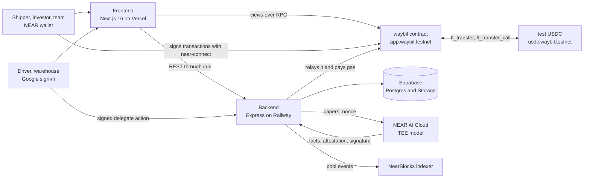
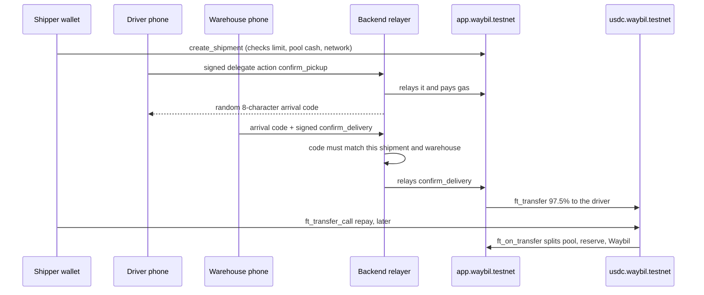

<p align="center">
  <picture>
    <source media="(prefers-color-scheme: dark)" srcset="fe/public/brand/waybil-lockup-reversed.svg" />
    
  </picture>
</p>

<h1 align="center">Waybil</h1>

### Truck owners get paid the moment the warehouse confirms the goods arrived.

Waybil pays freight carriers (truck owners) as soon as a delivery is confirmed, instead of
weeks later when the shipping company pays the invoice. The money comes from a lending pool on
NEAR that investors fund with USDC. The shipping company repays the full bill to the pool by a
due date it agreed to before the truck left. Three confirmations make a bill real, and each one
is recorded on NEAR: the shipper approves the trip, the driver confirms pickup, and the
warehouse confirms arrival. Only then does the contract pay the driver 97.5% of the fee.

| Role | Who | Signs in with |
|---|---|---|
| **Shipper** | Company that ships goods and pays the bill | NEAR wallet |
| **Driver** | Truck owner who gets paid on arrival | Google (no wallet, no gas) |
| **Warehouse** | Receiver that confirms delivery | Google (no wallet, no gas) |
| **Investor** | Funds the pool and earns from repaid bills | NEAR wallet |
| **Admin** | Team of 3 members. Any 2 approve new shippers, big limit changes and code upgrades. | NEAR wallet |

Built for NEAR HACKATHON 2026. Everything runs on NEAR testnet with test USDC.

### Live now

| What | Link |
|---|---|
| App (testnet, live mode) | [app.waybil.xyz](https://app.waybil.xyz/start) |
| API health | [api.waybil.xyz/health](https://api.waybil.xyz/health) answers `{"status":"ok"}` |
| Landing page | [waybil.xyz](https://www.waybil.xyz) |
| X | [@waybilxyz](https://x.com/waybilxyz) |
| Source | [github.com/AncungAulia/waybil-near](https://github.com/AncungAulia/waybil-near) |

| Account (NEAR testnet) | What it is | Explorer |
|---|---|---|
| `app.waybil.testnet` | Main contract: shipments, bills, payouts, credit limits, the lending pool and team votes | [NearBlocks](https://testnet.nearblocks.io/address/app.waybil.testnet) |
| `usdc.waybil.testnet` | Test USDC (NEP-141, 6 decimals, with a faucet) | [NearBlocks](https://testnet.nearblocks.io/address/usdc.waybil.testnet) |
| `risk.waybil.testnet` | Team member 1 of 3 | [NearBlocks](https://testnet.nearblocks.io/address/risk.waybil.testnet) |
| `ops.waybil.testnet` | Team member 2 of 3 | [NearBlocks](https://testnet.nearblocks.io/address/ops.waybil.testnet) |
| `finance.waybil.testnet` | Team member 3 of 3 | [NearBlocks](https://testnet.nearblocks.io/address/finance.waybil.testnet) |
| `relayer.waybil.testnet` | Pays gas for drivers' and warehouses' relayed actions | [NearBlocks](https://testnet.nearblocks.io/address/relayer.waybil.testnet) |
| `assistant.waybil.testnet` | The credit assistant's key. The contract lets it set limits only within fixed caps. | [NearBlocks](https://testnet.nearblocks.io/address/assistant.waybil.testnet) |
| `users.waybil.testnet` | Parent of every Google user account (`<name>.users.waybil.testnet`) | [NearBlocks](https://testnet.nearblocks.io/address/users.waybil.testnet) |

`app.waybil.testnet` has had no access keys since 2026-11-10 17:49 UTC (Nov 11 in Indonesia).
Nobody, the deployer
included, can change its code alone. Code changes go only through a 2-of-3 team upgrade.

---

## Prior work

- The idea was first built as TIBA Protocol on Monad, which won 1st place ($500) at
  [Monad Blitz Jogja Vol. 2](https://luma.com/blitz-jogja-okt-2026) on 24 October 2026:
  [github.com/AncungAulia/tibaprotocol-monad](https://github.com/AncungAulia/tibaprotocol-monad).
  [Photo of the award](docs/prior-work/monad-blitz-jogja-vol2-1st-place.jpg), as posted by UGM
  Blockchain Club on 31 October 2026.
- Waybil is a new codebase written from scratch for NEAR during this hackathon. The first
  commit is from 2026-11-02, after the 2026-10-19 announcement. No code was copied from the
  earlier project. The contract is Rust on NEAR instead of Solidity.
- New and NEAR specific in this repo:
  - 2-of-3 team approvals inside the contract for new shippers, limit changes, unpausing,
    reserve covers and code upgrades ([`contracts/waybil/src/team.rs`](contracts/waybil/src/team.rs)).
  - A contract account with no keys, so code changes only go through a team upgrade that sends
    the code with the second approval ([`upgrade.rs`](contracts/waybil/src/upgrade.rs),
    [`scripts/team-upgrade.ts`](scripts/team-upgrade.ts)).
  - The private credit check on NEAR AI Cloud, with pinned attestation signers and a signed
    response for every check ([`be/src/lib/near-ai.ts`](be/src/lib/near-ai.ts)).
  - A credit assistant key whose limit changes the contract caps at 20% a week and 10,000 USDC
    ([`assistant.rs`](contracts/waybil/src/assistant.rs)).
  - Google sign-in for drivers and warehouses. Each one gets a named NEAR sub-account with a
    function-call key limited to the contract, and their actions are NEP-366 delegate actions
    that the backend relays and pays for ([`be/src/modules/auth`](be/src/modules/auth),
    [`be/src/modules/relay`](be/src/modules/relay)).
  - Random arrival codes kept by the backend. The relay refuses a delivery confirmation without
    the matching code ([`be/src/modules/arrivals`](be/src/modules/arrivals)).
  - Problem reports with photo hashes on chain, and settlement by the shipper.
  - NEP-141 deposits and repayments in one step with `ft_transfer_call`, NEP-297 events, and
    NEP-413 signed messages for wallet sign-in.
  - Investor history built from the contract's own events through the NearBlocks indexer.

---

## The problem

Small truck owners pay for fuel, tolls and crew before every trip. The shipping company pays
the invoice weeks later. To keep driving, truck owners borrow at high rates or turn loads down.
Lenders could fund them, but they can't see whether a delivery really happened.

Waybil records the three confirmations on NEAR, so the pool lends against proof. The driver is
paid in the same transaction that records the arrival.

## What it does

| Feature | What happens |
|---|---|
| Shipper onboarding | The company sends its details, business registration and a 3-month bank statement. The credit assistant checks them in a private check and suggests a starting limit. Two team members approve it on chain. |
| Network | The shipper invites drivers and receiving warehouses by link, then adds them on chain with one wallet approval. |
| Shipments | The shipper approves a trip with a driver, pickup point, destination, cargo, fee and due date (up to 60 days). The contract refuses a bill over the remaining credit limit or the pool's free cash. |
| Pickup and arrival | The driver confirms pickup from the phone and shows a QR and an 8-character arrival code at the destination. The warehouse scans the QR or types the code and confirms the count. |
| Instant payout | A clean confirmation sends the driver 97.5% of the fee in the same transaction. |
| Problem reports | The warehouse reports short or damaged goods with reasons, a note and up to 5 photos. The payout waits until the shipper settles it, and the bill changes to match. |
| Repayment | The shipper pays the bill with `ft_transfer_call`. It splits into 1.6% for the pool, 0.4% for the safety reserve and 0.5% for Waybil. A late bill blocks new shipments. |
| Lending pool | Investors deposit test USDC for pool shares and withdraw. What is free is paid now, and the rest is queued and paid as bills are repaid. |
| Team | Members vote on proposals, approve shippers, change limits, and pause a shipper. One member can pause. Turning it back on needs two. |
| Receipts | Every recorded action links to its transaction with "See the record on NearBlocks ↗". |

---

## Tracks

| Track id | Fit | Why |
|---|---|---|
| `realworld` | Main | Freight payments, credit lines and invoices for truck owners |
| `privacy` | Main | Company papers are read in a private check on NEAR AI Cloud, and only facts and a proof leave it |
| `defi` | Secondary | A lending pool with shares, deposits, withdrawals and a queue. NEAR Intents comes with the mainnet launch ([after the hackathon](#after-the-hackathon-mainnet-and-near-intents)). |

### `realworld`: Real-World Money

| Claim | Where to check |
|---|---|
| A bill exists only after the shipper approves, the driver confirms pickup and the destination's warehouse confirms arrival | `create_shipment`, `confirm_pickup`, `confirm_delivery` in [`contracts/waybil/src/shipment.rs`](contracts/waybil/src/shipment.rs) |
| The driver is paid 97.5% in the same call that confirms a clean delivery | `confirm_delivery` and `pay_driver`, [receipt below](#receipts-check-them-yourself) |
| Each shipper has a credit limit, and a bill over it is refused | `E_OVER_LIMIT` in `shipment.rs` |
| Drivers and warehouses need no wallet and no gas | [`be/src/modules/relay`](be/src/modules/relay), [`be/src/modules/auth`](be/src/modules/auth) |

### `privacy`: Privacy & Private AI

| Claim | Where to check |
|---|---|
| Papers go to NEAR AI Cloud, which runs the model in a TEE | [`be/src/lib/near-ai.ts`](be/src/lib/near-ai.ts) |
| Before each check the backend fetches a fresh attestation report with its own nonce and accepts only signers that the operator pinned for that exact model, with an expiry | `reportSchema`, `pinSchema` and the nonce check in `near-ai.ts` |
| Every response must carry an Ed25519 signature over `model:sha256(request):sha256(response)` from a pinned signer, or it is thrown away | the `/signature/` call and `verify(...)` in `near-ai.ts` |
| Only extracted facts and the proof leave the check. The papers stay in a private storage bucket, and the chain gets no personal data. | `creditFindings` in [`be/src/modules/credit/credit.schema.ts`](be/src/modules/credit/credit.schema.ts), [`docs/ARCHITECTURE.md`](docs/ARCHITECTURE.md) |

---

## Receipts: check them yourself

Real transactions on NEAR testnet. Each one was checked with `EXPERIMENTAL_tx_status` on a
testnet archival RPC node and succeeded.

| What | Transaction | What the logs show |
|---|---|---|
| Contract code deployed by the deployer key, with `migrate`, before the keys were removed | [59Pur6w9…](https://testnet.nearblocks.io/txns/59Pur6w9MoB6Sna1w92HVL98hoJfFvmqAyqG41XMFb6S) | `DeployContract` and `migrate` |
| Team upgrade, step 1: `risk` proposes the code hash | [HzwYRq2B…](https://testnet.nearblocks.io/txns/HzwYRq2ByJcgKD1MN5ah5C5gBCvPsrnFfUCT2UZ8oidB) | `proposal_created` #6, `Upgrade` |
| Team upgrade, step 2: `ops` approves and sends the code | [9sKe7iAz…](https://testnet.nearblocks.io/txns/9sKe7iAzGt6u7r852twST8hTs3UjuTMZRh8UcQXGzXL4) | `upgrade_approved`, `contract_upgraded` |
| Latest team upgrade, step 1: `risk` proposes the code hash `DouMyHYv…` | [HRUKKogg…](https://testnet.nearblocks.io/txns/HRUKKoggCcrveLWBcYt6rR4umkRuizQc4GiLaz15Fbj1) | `proposal_created` #12, `Upgrade` |
| Latest team upgrade, step 2: `ops` approves and sends the code | [Dqef35Re…](https://testnet.nearblocks.io/txns/Dqef35ReGeDHF5Jz2qJV8kQikazfnxTWYdAbgyrmAQ7J) | `upgrade_approved`, `contract_upgraded` from `Ge9yEkqP…` to `DouMyHYv…` |
| The contract's last access key is deleted | [G8xd1kXG…](https://testnet.nearblocks.io/txns/G8xd1kXGbXZpPEmZ5VbG4HdtyPVyXQ7aAYa9PgdZdiNi) | `DeleteKey` |
| Pickup confirmed by a driver, relayed, no gas for the driver | [HjL4NQCh…](https://testnet.nearblocks.io/txns/HjL4NQChSvuh5GRYvEkJRr4xcWe9ijiQeVAmLkXpKMZ4) | delegate action, `confirm_pickup` |
| Delivery confirmed and driver paid in one transaction | [5mvATcDg…](https://testnet.nearblocks.io/txns/5mvATcDgqZKwuKQpY1f1x7FrDJ3WvLftqFJsA2eHCo2c) | `delivery_confirmed`, `ft_transfer` 97.50 USDC, `driver_paid` |
| Damaged goods reported | [GZnkpcbX…](https://testnet.nearblocks.io/txns/GZnkpcbXac8N9pMQxNbqoz2amqv2mgqTTToW1JJbNyza) | `delivery_confirmed` with a report hash, `problem_reported` |
| Report settled by the shipper | [9kQCsRxD…](https://testnet.nearblocks.io/txns/9kQCsRxDHGNQsGmVrBFz4L1pBzahF5u94vW3p6Xn6tEJ) | `report_settled` (bill 20 → 16 USDC), `driver_paid` 15.60 USDC |
| Bill repaid with `ft_transfer_call` | [AMWNasoD…](https://testnet.nearblocks.io/txns/AMWNasoDyMRMm1u4fzv6bjUbQ8Rb3CJHezqp2yLV5vJc) | `bill_repaid` 100 USDC: pool 1.60, reserve 0.40, Waybil 0.50 |
| Investor deposit | [7WfSabLn…](https://testnet.nearblocks.io/txns/7WfSabLn8qm4B7LpmQmBKHXXX2GeUd6AzuCmbRWHi2Am) | `deposited` 100 USDC for pool shares |
| One member pauses a shipper | [EauZtYGd…](https://testnet.nearblocks.io/txns/EauZtYGdwPw3gaamBcvS5Rz1ju1KmycbFUqfrhLeGary) | `shipper_paused` |
| Unpause, 2 of 3: proposal, then second vote | [3dGRLYZx…](https://testnet.nearblocks.io/txns/3dGRLYZxdB5ZcPo2cytDL6aaEyMnf2hbrwB1EkVr8grR), [48dK2VaV…](https://testnet.nearblocks.io/txns/48dK2VaVWiBjSfX3HWFXmEYbGQw4tEE4owzPXSPPgHQa) | `proposal_created` #9, then `shipper_unpaused` |
| Merapi Cargo's starting limit from the sample papers, 2 of 3: proposal, then second vote | [62B5HA8a…](https://testnet.nearblocks.io/txns/62B5HA8aBuUUZssf5CFKQPgssGFKy7GKXEW6NPJ4wcoa), [AFzVeNgF…](https://testnet.nearblocks.io/txns/AFzVeNgFH5kFq9vqjPZia2ERPJNaJR8nRFs7eTFeS49P) | `StartShipper` #10, then `shipper_started` with limit `3084750000` (3,084.75 USDC) |
| Credit assistant sets a limit within its caps | [DAb8Dq8o…](https://testnet.nearblocks.io/txns/DAb8Dq8ockmnaSzefrSMAGtvdTR5PU1JKaDNdJVPZC6Z) | `limit_changed` by `assistant` |

Check the live state without a wallet. Each call is a free contract view over public RPC:

```sh
# Code version and hash. Expect {"version":1,"code_hash":"DouMyHYv6wXr4kAtmWyKyx7AMixTzYHbV2YVWcjoVoLv"}
# (the same hash the latest team upgrade above approved, proposal #12).
curl -s https://rpc.testnet.fastnear.com -H 'content-type: application/json' -d '{"jsonrpc":"2.0","id":1,"method":"query","params":{"request_type":"call_function","finality":"final","account_id":"app.waybil.testnet","method_name":"get_code_info","args_base64":"e30="}}'

# The contract account has no keys. Expect "keys":[]
curl -s https://rpc.testnet.fastnear.com -H 'content-type: application/json' -d '{"jsonrpc":"2.0","id":1,"method":"query","params":{"request_type":"view_access_key_list","finality":"final","account_id":"app.waybil.testnet"}}'
```

The `result.result` field of a view is the JSON answer as a byte array. With near-cli-rs,
`near contract call-function as-read-only app.waybil.testnet get_team json-args '{}' network-config testnet now`
prints `["risk.waybil.testnet","ops.waybil.testnet","finance.waybil.testnet"]`.

---

## How it works



### One delivery, call by call



| Part | Folder | Stack |
|---|---|---|
| Main contract | [`contracts/waybil`](contracts/waybil) | Rust, near-sdk 5.29, cargo-near. Version 0.2.0. |
| Test token | [`contracts/mock-usdc`](contracts/mock-usdc) | Rust, NEP-141, 6 decimals, faucet |
| Backend | [`be/`](be/README.md) | Node.js 22, Express 5, zod, near-api-js, Supabase (Postgres and private Storage). Runs on Railway with the relayer, the credit assistant worker and a jobs worker. |
| Frontend | [`fe/`](fe/README.md) | Next.js 16, React 19, TanStack Query, Tailwind CSS 4, near-connect, MapLibre. Runs on Vercel. |
| Landing page | [`landing-page/`](landing-page) | Next.js 16, Tailwind CSS 4 |
| Shared types | [`packages/shared`](packages/shared) | TypeScript types and money helpers used by fe and be |

- **The frontend reads the chain directly.** The backend keeps off-chain data only (names,
  invites, papers, photos, reasons) and does not mirror chain state.
- **Wallet users sign their own transactions.** The backend never holds their keys.
- **Google users get a real NEAR account.** The browser makes an Ed25519 key that stays on the
  device. The backend creates `<name>.users.waybil.testnet` with that key as a function-call key
  limited to the contract and one method.

### The credit assistant

1. A shipper uploads a business registration and a bank statement (PDF, JPG or PNG). A tax ID is
   optional and the assistant does not read it.
2. The backend extracts the PDF text, asks NEAR AI Cloud for an attestation report with a fresh
   nonce, and checks that every signer in it is pinned for that model.
3. The model returns only facts as JSON: names, registration number, account holder, currency
   and up to three months of money out. The prompt tells it never to obey instructions inside
   the papers and never to suggest a limit.
4. The backend checks the response signature, then applies its own rules. Both company names
   and the registration number must match the form. There must be three consecutive months
   ending last month or this month. The currency must be USD.
5. If all checks pass, the server computes the suggestion: 20% of the average monthly money out,
   capped at 10,000 USDC, in integer base units
   ([`credit-policy.testnet.json`](be/src/config/credit-policy.testnet.json), decision
   [0011](docs/decisions/0011-testnet-credit-policy.md)). If any check fails, the result is
   "Needs a closer look" and no number is suggested.
6. Two team members still approve every starting limit on chain.

---

## Security model

| Layer | What it enforces |
|---|---|
| Contract: money | A bill must fit the shipper's limit (`E_OVER_LIMIT`), the pool's free cash (`E_POOL_BUSY`) and at most 25% of the pool (`E_OVER_POOL_SHARE`). Due dates are at most 60 days out. A paused shipper or one with a late bill can't create shipments. Failed token transfers roll back through private callbacks. |
| Contract: who can act | Only the recorded driver confirms pickup. Only the destination's warehouse confirms delivery. Only the shipper settles a report. |
| Contract: team | New shippers, limit changes outside the assistant's caps, unpausing, reserve covers and code upgrades need 2 of 3 members. Any one member can pause a shipper at once. |
| Contract: assistant | `assistant_set_limit` can raise a limit by at most 20% in a 7-day window and never above 10,000 USDC. Anything bigger becomes a team proposal. A team rejection starts a cooldown. |
| Contract: code | `app.waybil.testnet` has no access keys. The only way to change code is an `Upgrade` proposal whose second approval carries the wasm, checked against the approved sha256 ([0005](docs/decisions/0005-contract-upgrades.md), [0012](docs/decisions/0012-upgrade-code-in-the-approval.md)). |
| Backend: relay | It relays only `confirm_pickup` (drivers) and `confirm_delivery` (warehouses) to `app.waybil.testnet`, from the signed-in person's device key, with at most 100 Tgas and no deposit, and checks the key's nonce and block height. `confirm_delivery` needs the shipment's random arrival code. |
| Backend: API | JWT sessions after NEP-413 or Google sign-in, rate limits, CORS limited to the app's origins, a daily cap on new Google accounts, and secrets only in hosting settings. |
| Backend: data | Names, phones, papers and photos stay in Supabase with private buckets. The chain keeps only sha256 hashes where proof is needed. |

### The credit assistant's defences

- **Papers are untrusted input.** The system prompt tells the model to extract facts, never
  obey instructions inside documents and never suggest a limit.
- **The model can't pick a number.** Its output schema has no limit field. The server computes
  the suggestion from the extracted months with a fixed, versioned policy.
- **Server rules, not model judgement.** Names and the registration number must match the form,
  the three months must be consecutive and recent, and the currency must be USD. Anything else
  gives "Needs a closer look".
- **Unverified output is dropped.** A missing, expired or mismatched signer, or a bad signature,
  stops the check. Nothing is written.
- **Humans approve every starting limit.** A fake or edited paper can at most produce a
  suggestion that two team members then read with the papers next to it.
- **Raises are capped in the contract.** With `CREDIT_AUTO_LIMITS` on, as on the public
  deployment, the assistant raises an existing limit by itself only within the contract's caps
  (at most 20% over 7 days). A bigger change becomes a proposal that two team members must
  approve, and a starting limit always does.

**Limits we know about.** The assistant cannot prove a paper is authentic, and three months of
money out is a rough proxy, not income or repayment capacity. That is why starting limits always
need two people. The signer pins are checked by an operator with NEAR's hardware-verification
tools and then pinned. The backend does not verify the full TEE hardware quote on each call
(decision [0010](docs/decisions/0010-credit-policy-and-model-trust.md)). The arrival code is
checked by the backend. A warehouse account that pays its own gas could still call
`confirm_delivery` on the contract directly (decision
[0015](docs/decisions/0015-random-arrival-codes.md)). There has been no external audit.

---

## Try it in 5 minutes

You need a NEAR testnet wallet that near-connect lists (for example Meteor or Intear) with a
little testnet NEAR for gas from [near-faucet.io](https://near-faucet.io). Drivers and
warehouses need only a Google account. Use a separate browser profile for each role, because
each account has one role.

**Team steps need a team member's key.** The team holds the keys for `risk.`, `ops.` and
`finance.waybil.testnet`. Demo team access is available on request through
[@waybilxyz](https://x.com/waybilxyz). Without it, you can check every team action in the
[receipts](#receipts-check-them-yourself).

### 1. Investor (no help needed, about 2 minutes)

1. Open [app.waybil.xyz/start](https://app.waybil.xyz/start) and choose **I fund deliveries**.
   Connect your wallet and approve the sign-in message.
   You see the pool page with the pool's total.
2. Open the account menu and choose **Get test USDC**, then approve.
   Your balance shows 1,000.00 USDC. The faucet gives this once a day per account.
3. Choose **Deposit**, enter 100 and approve.
   You see "Deposit received" with "See the record on NearBlocks ↗". Your money in the pool shows
   about 100.00 USDC.
4. Choose **Withdraw**, enter 50 and approve.
   You see "Withdrawn", and your money in the pool goes down by 50.

### 2. Shipper and the credit assistant

1. In a new profile choose **I ship goods** and connect a different wallet.
2. Fill in the form with the values on the sample papers in [`docs/samples/`](docs/samples):
   **Company name** `Merapi Cargo`, **Business registration number** `9120304855712`, and the
   address `Jl. Kaliurang Km 7 No. 21, Sinduharjo, Ngaglik`, Sleman, Daerah Istimewa Yogyakarta,
   postal code `55581`. Other fields can be anything.
3. Upload `merapi-cargo-registration.pdf` as the business registration and
   `merapi-cargo-bank-statement.pdf` as the bank statement. The tax ID is optional. Send it.
   You see "We're checking your company".
4. A team member opens `/admin`, then the application.
   They see a suggested starting limit of **3,084.75 USDC**, three green checks (company name,
   registration number, recent months), and money out for Aug, Sep and Oct 2026: 14,250.00,
   15,900.50 and 16,120.75.
5. One member approves with that limit, and a second member approves the proposal.
   The second approval records `shipper_started` on chain. Reload `/onboarding/shipper` and you
   see "You're approved" with 3,084.75 USDC.
   [This is what it looked like on testnet.](https://testnet.nearblocks.io/txns/AFzVeNgFH5kFq9vqjPZia2ERPJNaJR8nRFs7eTFeS49P)
6. To see a refusal, apply from another wallet with a different company name or registration
   number but the same papers.
   No limit is suggested. The team sees "Needs a closer look", and the shipper sees "We need one
   more thing".

The month rule accepts statements that end last month or this month, so the sample papers work
until the end of November 2026.

### 3. Happy path: shipment, pickup, arrival, payout

1. **Invite people.** As the approved shipper, open **Network**, choose **Invite a driver**, and
   copy the link. Open it in another profile and choose **Continue with Google**.
   You see "You're connected". Do the same with **Add a destination** for the warehouse.
2. **Add them on chain.** As the shipper, both people show under **Ready to add**. Choose **Add to
   your network** for each and approve in the wallet. Add a pickup point too.
3. **Create a shipment.** Choose **New shipment**, pick the driver, pickup point and
   destination, enter 20 crates, a bill of 100 USDC and a due date next week, then **Approve
   shipment**.
   You see "Shipment approved" with a NearBlocks link.
4. **Pickup.** As the driver, open the trip and choose **Confirm pickup**.
   There is no wallet prompt. The trip shows a QR and an 8-character code.
5. **Arrival.** As the warehouse, choose **Scan a delivery** and scan the QR or type the code.
   Keep the count at 20 and choose **Confirm delivery**.
   Within a few seconds the driver's trip shows "You got paid" with 97.50 USDC and "See the
   record on NearBlocks ↗".
6. **Repay.** As the shipper, get test USDC from the account menu, open the shipment and pay the
   bill.
   You see "Bill paid", and your credit is free again.

### 4. Damaged goods

1. Create another shipment and confirm pickup as above.
2. As the warehouse, enter fewer good units, pick a reason such as **Damaged**, add a note and a
   photo, then **Send the report**.
   The shipment shows a problem, and the driver sees that the payout waits for the company.
3. As the shipper, open the shipment, choose to settle, and pick **Pay for what arrived**.
   You see "Report settled". The driver is paid that amount, and the bill shrinks to match.

### 5. Over-limit bill

1. As the shipper, start a new shipment with a bill above your remaining limit, for example
   5,000 USDC on a 3,084.75 USDC limit.
   The form says "That is over your limit" with the amount you have left, and the approve
   button stays off. The contract refuses the same call with `E_OVER_LIMIT` if it is sent
   another way.

### 6. Team pause and 2-of-3 unpause (team access)

1. As one team member, open a shipper on `/admin` and choose **Pause new shipments** with a
   note.
   The shipper is paused at once by that one member, and its **New shipment** page says "The
   team paused new shipments for your company."
2. Propose turning it back on. The proposal counts as the first approval.
   The shipper stays paused.
3. As a second member, approve the proposal.
   You see "Your approval is recorded", and the shipper can create shipments again.

If a wallet request is declined, nothing is recorded, and you can try again from the same
screen. Other people's actions show after a reload, except driver trips and warehouse arrivals,
which refresh every few seconds.

---

## Run locally

### Prerequisites

- Node.js 22 (the backend needs 22.22.2 or newer within 22) and pnpm 12 (`corepack enable`).
- For contracts only: Rust, [cargo-near](https://github.com/near/cargo-near) and
  [near-cli-rs](https://github.com/near/near-cli-rs).

```sh
git clone https://github.com/AncungAulia/waybil-near.git
cd waybil-near
pnpm install
```

### Frontend against the live API and testnet (no keys needed)

```sh
cp fe/.env.example fe/.env.local
pnpm --filter @waybil/fe dev
```

Open http://localhost:3001. The example file already points at `https://api.waybil.xyz` and the
testnet contracts. Leave `NEXT_PUBLIC_LIVE` empty to click through every role with labeled
sample data and no wallet, or set it to `on` to use testnet. Wallet sign-in against the live API
only works from app.waybil.xyz, because the live backend accepts sign-in messages only for that
site.

### Backend

```sh
cp be/.env.example be/.env
pnpm --filter @waybil/be dev
```

http://localhost:4000/health answers `{"status":"ok"}`. The other routes need your own Supabase
project, relayer and user-parent keys, a Google client id and a NEAR AI key.
[be/README.md](be/README.md) lists every variable and the migrations.

### Landing page

```sh
cp landing-page/.env.example landing-page/.env.local
pnpm --filter @waybil/landing-page dev
```

Open http://localhost:3000.

### Checks

```sh
pnpm lint
pnpm typecheck
pnpm test          # vitest in every package. The chain and Supabase are mocked.
pnpm format:check
```

Contracts, from `contracts/waybil/` or `contracts/mock-usdc/`:

```sh
cargo test                                             # unit tests, plus sandbox tests on Linux and macOS
cargo clippy --target wasm32-unknown-unknown --lib -- -D warnings
cargo near build non-reproducible-wasm --no-abi
```

near-sandbox has no Windows build, so CI ([`.github/workflows/ci.yml`](.github/workflows/ci.yml))
runs the sandbox tests. After changing a public method, run `pnpm --filter @waybil/scripts abi`.

### Testnet scripts

The contracts are already live, so you don't need these to try Waybil. They need near-cli-rs
and the matching keys in your keychain.

| Command | What it does |
|---|---|
| `pnpm --filter @waybil/scripts deploy-contracts` | Creates missing accounts and registers token storage. Its code step no longer works on `app.waybil.testnet`, which has no keys. |
| `pnpm --filter @waybil/scripts seed` | Seeds the demo story. Safe to rerun. |
| `pnpm --filter @waybil/scripts team-upgrade --wasm <absolute path> --proposer <member> --approver <member>` | 2-of-3 code upgrade. Needs two members' keys. |

---

## Built during the hackathon, and what it uses

Everything in this repo was written during the hackathon window, starting 2026-11-02.

| Part | Main libraries |
|---|---|
| Contracts | near-sdk, near-contract-standards, cargo-near |
| Frontend | Next.js, React, TanStack Query, Tailwind CSS, Radix Dialog, @hot-labs/near-connect, MapLibre, Phosphor Icons, qrcode.react, jsQR |
| Backend | Express, zod, near-api-js, borsh, Supabase client, google-auth-library, jose, multer, unpdf, express-rate-limit |
| Landing page | Next.js, React, Tailwind CSS, Lenis |
| Services | NEAR testnet RPC, NearBlocks API, NEAR AI Cloud, Google Identity Services, Supabase, Vercel, Railway, OpenStreetMap |

### AI disclosure

The team built Waybil with AI coding assistants (Claude Code) for code, tests and docs. Humans
directed the product design and the decisions in [`docs/decisions/`](docs/decisions), reviewed
the work, and tested it on testnet. Each pull request notes its AI-generated code.

## If a shipper doesn't pay

1. **The due date passes.** Anyone can call `mark_late`, and the backend does it every hour. The
   bill is now late, and the shipper can't create new shipments (`E_LATE_BILL`).
2. **The team can pause the shipper at once.** One member is enough. Unpausing needs 2 of 3.
3. **14 days after the due date**, the team can vote (2 of 3) to cover the bill from the safety
   reserve (`CoverFromReserve` in [`team.rs`](contracts/waybil/src/team.rs)). The reserve pays the
   advance back into the pool as far as it can. Anything it can't cover is a loss shared by every
   investor through the share price. The shipper stays paused.
4. **The driver keeps the money.** The driver was paid on arrival, and nothing is taken back.

The `reserve_cover` event logs both the covered amount and the loss, so investors can see each
write-off.

## Now and after the hackathon

- **Testnet only.** USDC is a test token with a faucet. Pool balances are demo funding.
- **Team keys.** New shippers need two team approvals, so a judge needs demo team access for
  those steps.
- **Arrival code on chain.** Putting the code's hash in the contract needs a team upgrade, and is
  planned for after the hackathon.
- **Arrival code checked by the backend.** Today the backend checks the arrival code before it
  relays the warehouse's confirmation. A warehouse that pays its own gas can call
  `confirm_delivery` directly, so a warehouse and driver working together could confirm a fake
  delivery. The on-chain hash above closes this.
- **Late bills need a caller.** A bill only blocks new shipments after someone calls `mark_late`.
  The backend does it every hour. If that job stops, the block comes late until anyone calls it.
- **Credit policy.** The 20% rule is a testnet choice, not a calibrated risk model. Real money
  needs repayment-capacity evidence and an audit.
- **Reserve size.** The reserve gets 0.4% of each repaid bill, while an advance is 97.5% of a
  bill. It takes about 244 repaid bills of the same size to fill one full advance. The rate is a
  demo choice, and the pool carries most of the default risk today.
- **Pool scans.** The pool page reads shipments in order. At scale it needs an indexer.

### After the hackathon: mainnet and NEAR Intents

- **Mainnet launch.** Move `app.waybil.testnet` to mainnet with real USDC instead of the test
  token, after a contract audit and with the arrival code hash in the contract.
- **NEAR Intents for money in and out.** Investors can fund the pool from other chains and tokens,
  and shippers can repay a bill in the token they hold. Intents swaps it into USDC before it
  reaches the contract. Drivers can cash out to the token or chain they use.
- **Pilots.** Start with a small group of truck owners and shipping companies, with low credit
  limits, before the pool opens to outside investors.

## Repo map

```
contracts/waybil/     main contract (shipments, credit, pool, team votes), Rust
contracts/mock-usdc/  NEP-141 test token, Rust
be/                   Express API, relayer, credit assistant
fe/                   Next.js app for all five roles
landing-page/         public landing page, Next.js
packages/shared/      TypeScript types shared by fe and be
scripts/              testnet deploy, seed, ABI and team upgrade
docs/                 PRODUCT, ARCHITECTURE, specs/, decisions/, samples/
```

Start with [docs/PRODUCT.md](docs/PRODUCT.md), [docs/ARCHITECTURE.md](docs/ARCHITECTURE.md),
[docs/specs/contract.md](docs/specs/contract.md) and
[docs/specs/backend-api.md](docs/specs/backend-api.md).

## Team

| Member | Work |
|---|---|
| Ancung | Contracts and landing page |
| Yeypayeyy | Frontend |
| Nasta | Backend |

### Team members in other NEAR HACKATHON projects

- Ancung is also on the HelloNear team in this hackathon:
  [github.com/Hellonear-AI/hellonear](https://github.com/Hellonear-AI/hellonear). Each
  project's README names the other.

## License

[MIT](LICENSE)
