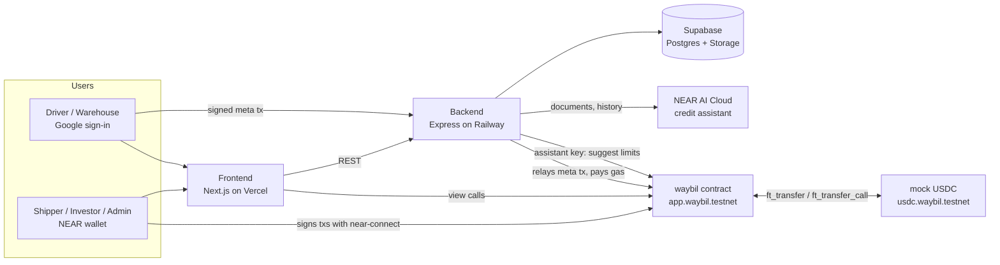

# Waybil · Architecture

This is the source of truth for **how** Waybil is built. What the product does lives in
`docs/PRODUCT.md`. Interfaces live in `docs/specs/contract.md` and `docs/specs/backend-api.md`.

## Overview

## Components

| Part | Folder | Stack | Owner |
|---|---|---|---|
| Main contract | `contracts/waybil` | Rust, near-sdk 5.x, cargo-near | Ancung |
| Test token | `contracts/mock-usdc` | Rust, NEP-141, 6 decimals | Ancung |
| Frontend | `fe/` | Next.js (App Router), TypeScript, Tailwind CSS, shadcn/ui, near-connect, MapLibre + OpenStreetMap | Yeypayeyy |
| Backend | `be/` | Node.js, TypeScript, Express, near-api-js, Supabase client | Nasta |
| Shared types | `packages/shared` | TypeScript | everyone |
| Scripts | `scripts/` | TypeScript (deploy, seed) and shell | Ancung |

The repo is a **pnpm workspace** (`fe`, `be`, `packages/*`). Contracts build with Cargo.
Folder layout and naming per app: `docs/STRUCTURE.md`.

## Who talks to whom

- **Wallet users** (shippers, investors, admin) sign transactions themselves through
  near-connect. The frontend calls the contract directly for these.
- **Google users** (drivers, warehouses) never see a wallet.
  1. The browser makes a key pair and keeps the private key on the device.
  2. After Google sign-in, the backend creates `<name>.users.waybil.testnet` with that public key
     as a function-call key limited to the waybil contract.
  3. The browser signs each action as a NEP-366 delegate action. The backend relays it
     and pays the gas. The device key never leaves the browser.
  4. The backend keeps one recovery key per Google account, so a lost phone can be replaced
     after signing in with Google again (see 0004).
- **The credit assistant** runs in the backend. It sends papers and history to NEAR AI Cloud,
  then calls the contract with the assistant key to set or propose a limit.
- **Reads:** the frontend reads contract views over RPC. The backend keeps off-chain data only
  (names, phones, papers, photos, reasons, invites) and does not mirror chain state.

## Where data lives

| Data | Where | Why |
|---|---|---|
| Shipments, bills, payouts, limits, pool, votes | Contract | Money and proof |
| Photo and document hashes | Contract | Proof that files didn't change |
| Names, phones, emails, addresses | Supabase Postgres | Personal data stays off-chain |
| Papers and report photos | Supabase Storage (private buckets) | Large files, private |
| Reject reasons, report notes, invites | Supabase Postgres | Not needed for money rules |

## Money flow

- Token: `usdc.waybil.testnet`, NEP-141, 6 decimals. Amounts are `U128` strings of base units.
- Deposits and repayments come in with `ft_transfer_call` to the contract.
- Payouts and withdrawals go out with `ft_transfer`. State changes first, and a private
  callback rolls them back if the transfer fails.

## Accounts (testnet)

| Account | Role |
|---|---|
| `waybil.testnet` | Deployer, parent of every Waybil account |
| `app.waybil.testnet` | Main contract |
| `usdc.waybil.testnet` | Mock USDC |
| `relayer.waybil.testnet` | Pays gas for meta transactions |
| `users.waybil.testnet` | Parent of Google user accounts (`<name>.users.waybil.testnet`). Only a parent can create sub-accounts on NEAR, so the backend holds this key instead of the admin key. Created with issue #16. |
| `assistant.waybil.testnet` | Credit assistant key (allowed to set limits within caps) |
| `treasury.waybil.testnet` | Receives Waybil's 0.5% |
| `risk.`, `ops.`, `finance.waybil.testnet` | The three team members |
| `shipper.`, `driver.`, `warehouse.`, `investor.waybil.testnet` | Demo users |

## NEAR features used

Rust contract with near-sdk 5.x, NEP-141 token, `ft_transfer_call`, NEP-297 events,
NEP-366 meta transactions with a relayer, function-call access keys, NEP-413 signed
messages for backend sign-in, NEAR AI Cloud for the private credit check.

## Environments

| Thing | Where |
|---|---|
| Frontend | Vercel, preview per PR |
| Backend | Railway, deploys from `main` |
| Database and files | Supabase project `waybil` |
| Chain | NEAR testnet |

Secrets live in each platform's settings and local `.env` files that are never committed.
Each app has a `.env.example` with empty values.

## Decisions behind this

`docs/decisions/0001` one contract, `0002` team approvals and assistant limits,
`0003` payouts and fees, `0004` stack and in-contract team voting, `0005` contract upgrades.
